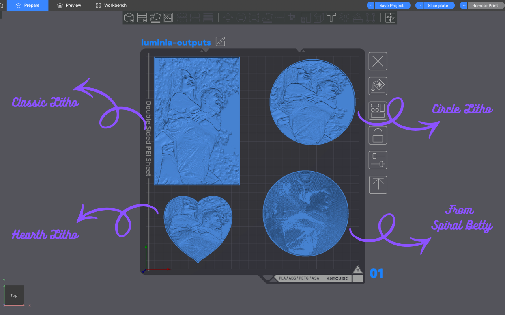
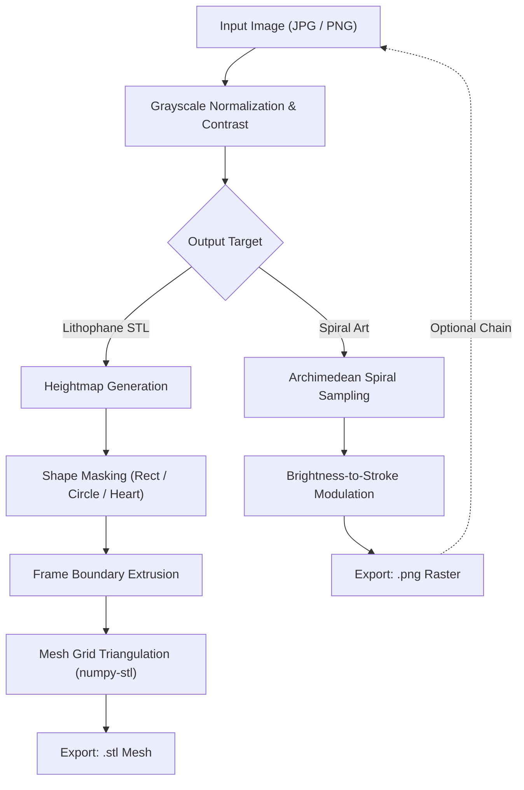
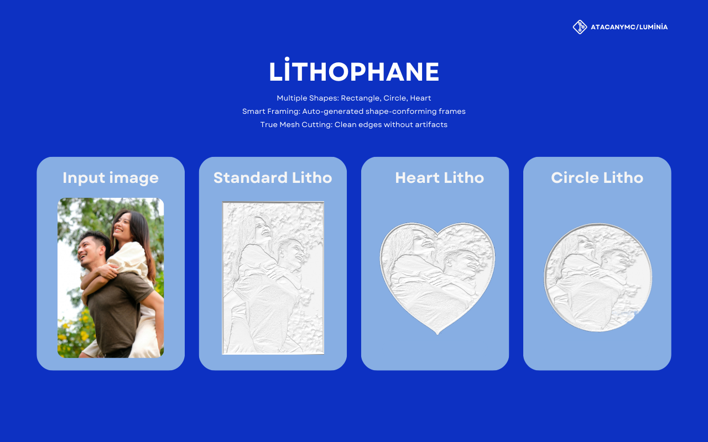
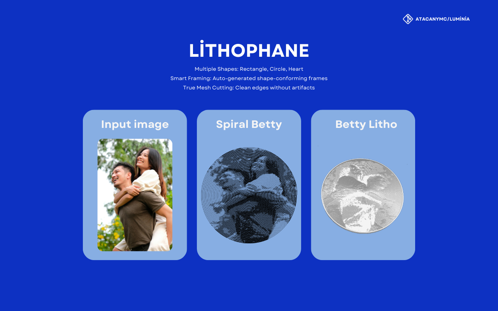

# Lumina

[](https://www.python.org/downloads/)
[](https://pypi.org/project/lumina-tools/)
[](https://github.com/AtaCanYmc/lumina/actions/workflows/python-ci.yml)
[](https://opensource.org/licenses/MIT)

Lumina converts 2D raster images into 3D-printable lithophane STL meshes and Spiral Betty vector or raster art. It provides both a Python API and a command-line interface.

## Table of Contents

- [Overview and Output Types](#overview-and-output-types)
- [Architecture Pipeline](#architecture-pipeline)
- [Installation](#installation)
- [Quick Start](#quick-start)
  - [Create a Flat or Shaped Lithophane](#create-a-flat-or-shaped-lithophane)
  - [Generate Spiral Betty Art](#generate-spiral-betty-art)
  - [Chaining Spiral Art into a Lithophane Mesh](#chaining-spiral-art-into-a-lithophane-mesh)
- [Command-Line Interface (CLI)](#command-line-interface-cli)
  - [CLI Commands](#cli-commands)
  - [CLI Flags Reference](#cli-flags-reference)
- [Technical FAQ](#technical-faq)
- [Development and Verification](#development-and-verification)
- [Documentation](#documentation)
- [License](#license)

## Overview and Output Types

| Feature | Description | Output Format |
| :--- | :--- | :--- |
| Flat and Shaped Lithophanes | Converts image grayscale intensity into variable Z-height geometry with boundary framing | Binary `.stl` mesh |
| Spiral Betty Generator | Samples image brightness along Archimedean spiral paths with modulated line thickness | Grayscale `.png` image |

<p align="center">
  
</p>

## Architecture Pipeline



## Installation

Install the package from PyPI:

```bash
pip install lumina-tools
```

Or install from source in editable mode:

```bash
git clone https://github.com/AtaCanYmc/lumina.git
cd lumina
pip install -e .
```

## Quick Start

### Create a Flat or Shaped Lithophane

```python
from lumina import flat_lithophane

mesh = flat_lithophane(
    image_path="photo.jpg",
    shape="heart",  # rect, circle, heart
    width_mm=100.0,
    max_thickness=3.0,
    min_thickness=0.5,
)
mesh.save("lithophane.stl")
```

<p align="center">
  
</p>

### Generate Spiral Betty Art

```python
import cv2
from lumina import generate_spiral_betty_png

spiral = generate_spiral_betty_png(
    image_path="portrait.jpg",
    radius_mm=50.0,
    lines=30,
)
cv2.imwrite("spiral_art.png", spiral)
```

### Chaining Spiral Art into a Lithophane Mesh

You can pipe the generated spiral image directly into `flat_lithophane` to generate a textured 3D lithophane model:

```python
import cv2
from lumina import flat_lithophane, generate_spiral_betty_png

# 1. Generate the spiral raster image
spiral_img = generate_spiral_betty_png("portrait.jpg", radius_mm=50.0, lines=35)
cv2.imwrite("spiral_temp.png", spiral_img)

# 2. Convert the spiral raster into a 3D printable STL mesh
mesh = flat_lithophane(
    image_path="spiral_temp.png",
    shape="circle",
    width_mm=100.0,
    max_thickness=2.8,
    min_thickness=0.6,
)
mesh.save("spiral_lithophane.stl")
```

<p align="center">
  
</p>

## Command-Line Interface (CLI)

The package provides the `lumina` console command as well as module execution via `python -m lumina.cli`.

### CLI Commands

```bash
# Generate a circular lithophane STL
lumina flat photo.jpg --shape circle --width 120 --output circle_litho.stl

# Generate a Spiral Betty PNG
lumina spiral portrait.jpg --radius 100 --lines 40 --output spiral_art.png
```

### CLI Flags Reference

#### `lumina flat`

| Flag | Short | Default | Description |
| :--- | :--- | :--- | :--- |
| `--output` | `-o` | `[input].stl` | Destination path for the generated STL file. |
| `--width` | `-w` | `100.0` | Target width in millimeters. |
| `--height` | `-h` | `150.0` | Target height in millimeters. |
| `--max-thick` | | `3.0` | Maximum thickness in millimeters for darkest pixels. |
| `--min-thick` | | `0.5` | Minimum thickness in millimeters for lightest pixels. |
| `--frame-thick` | | `1.0` | Frame border width in millimeters. |
| `--frame-height`| | `2.0` | Frame border height in millimeters. Set to `0` to match maximum relief height. |
| `--resolution` | `-r` | `5` | Resolution in pixels per millimeter. |
| `--shape` | | `rect` | Boundary geometry: `rect`, `circle`, `heart`. |
| `--enhance / --no-enhance` | | `False` | Apply contrast enhancement before processing. |
| `--normalize / --no-normalize` | | `False` | Normalize grayscale levels across dynamic range before processing. |

#### `lumina spiral`

| Flag | Short | Default | Description |
| :--- | :--- | :--- | :--- |
| `--output` | `-o` | `[input]_spiral.png` | Destination path for the generated PNG image. |
| `--radius` | `-r` | `100.0` | Spiral radius in millimeters. |
| `--resolution` | | `5` | Resolution in pixels per millimeter. |
| `--lines` | | `30` | Number of concentric spiral rotations. |
| `--angle-step` | | `0.05` | Angular sampling increment in radians. |

## Technical FAQ

### How does grayscale mapping determine physical thickness?
Dark pixels map to `max_thickness` and white pixels map to `min_thickness`. When backlit, thicker regions absorb more light and appear dark, while thinner regions allow light transmission and appear bright.

### What slicer settings produce the best lithophane prints?
Print lithophanes vertically aligned along the Y-axis rather than lying flat on the build plate. Set infill to 100% to avoid internal hollow grid patterns when backlit. Use a layer height of 0.12 mm or finer with white or natural PLA.

### How does resolution influence generation time and file size?
The resolution parameter controls grid density in pixels per millimeter. Mesh vertex count scales quadratically with resolution. A value of 5 pixels per millimeter provides high fidelity without creating excessively large STL files.

### Can custom frame dimensions be disabled?
Yes. Setting `--frame-thick 0` generates a frameless mesh with edge-to-edge relief.

## Development and Verification

### Local Environment Setup

```bash
python -m venv .venv
source .venv/bin/activate
pip install -r requirements.txt
pip install -e .
```

### Running Tests

Execute the automated test suite with `pytest`:

```bash
pytest
```

### Code Style and Formatting

The repository enforces formatting via `isort`, `black`, and `ruff`:

```bash
isort --check-only .
black --check .
ruff check .
```

## Documentation

- [Python API Reference](docs/API.md): Function parameters, types, and return values.
- [CLI Reference](docs/CLI.md): Terminal usage, commands, and options.
- [Contributing Guide](docs/CONTRIBUTING.md): Branching, commit standards, and pull request workflow.

## License

This project is licensed under the MIT License. See [LICENSE](LICENSE) for details.
